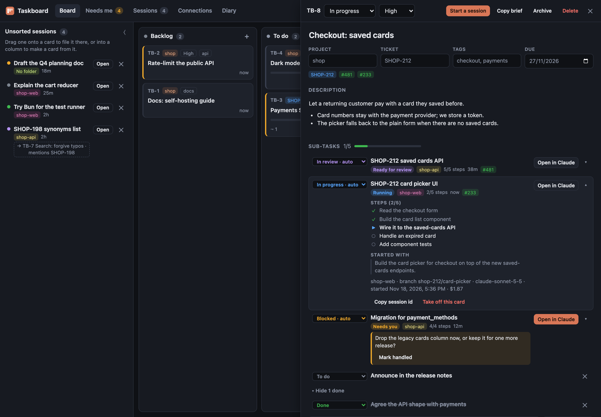
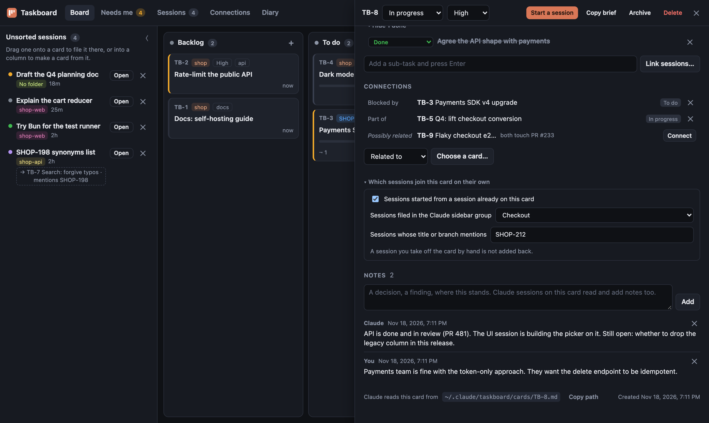
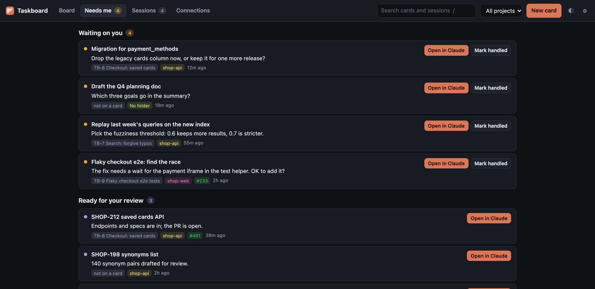
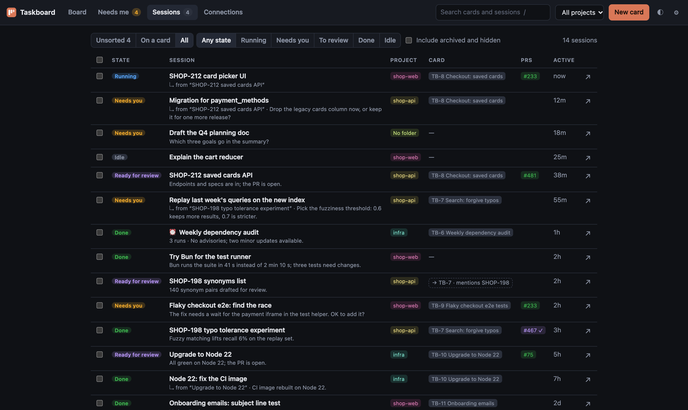
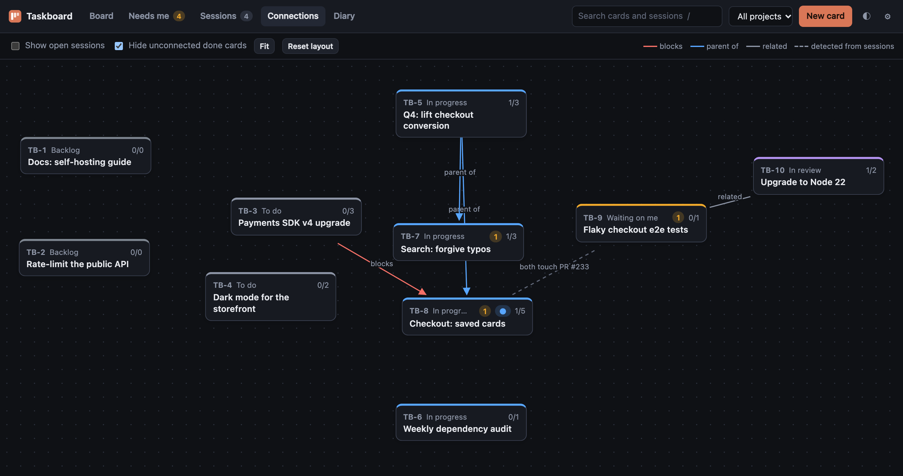

# Taskboard

A local kanban board over your Claude sessions.

A **card** is a task. Its **sub-tasks** are checklist items or **Claude sessions**, and a linked session's status (running, needs you, ready for review, done) is read live from Claude's own files, so nobody has to keep it up to date. Cards can be **connected** (blocks, parent of, related), and Claude sessions can read and update the board themselves.


It is for people who run many Claude Code sessions on related work and lose track of which session belongs to which task, which ones are waiting for an answer, and what is left.

- Runs on your Mac only: a small web server on `127.0.0.1`, one JSON file for the board, no account, no dependencies.
- Reads the Claude desktop app's and Claude Code's session files. It never changes them.
- Comes with a Mac app (Dock icon, menu-bar count of sessions waiting on you), a `/board` skill and `board_*` tools for Claude, and a `taskboard` command.

The screenshots here show made-up data from [`scripts/demo.js`](scripts/demo.js).

> This is a personal tool, not an Anthropic product. Built and tested on macOS with the Claude desktop app's Code tab and the Claude Code CLI.

## Install

You need macOS, Node 18 or newer, and Claude Code (the `claude` command) and/or the Claude desktop app. The Mac app is optional and needs Xcode's command line tools (`xcode-select --install`).

```bash
git clone https://github.com/mohamedelkadi/claude-taskboard.git
```

```bash
cd claude-taskboard && node src/cli.js install
```

The installer:

1. copies the app to `~/.claude/taskboard/app` (you can delete the clone afterwards)
2. adds the `taskboard` command to `~/.local/bin`
3. installs the `board` skill and registers the `taskboard` MCP server for every Claude Code session
4. starts the board at <http://127.0.0.1:4780/>
5. builds `~/Applications/Taskboard.app` if Swift is available

The first time it runs, it makes a starting board from what it finds: one card per Claude sidebar group, per family of sessions started from one another, and per scheduled task. Sessions that were already open keep working, but need a restart to get the board tools.

To look around without touching your own files, run it on made-up data instead:

```bash
node scripts/demo.js
```

## How to use it

### 1. Open the board

| Where you are | How |
| --- | --- |
| Anywhere on the Mac | The **Taskboard** app: Dock, Launchpad or Spotlight. Its Dock icon carries a badge with the number of sessions waiting on you. |
| Menu bar | The Taskboard item shows the same number. Its menu lists the waiting sessions; clicking one opens that session in Claude. |
| Inside a Claude session | Type `/board`. In the desktop app the board opens in the pane beside the chat. |
| Terminal | `taskboard`, or `taskboard open TB-3` to land on a card. |
| Browser | <http://127.0.0.1:4780/> |

"Open at Login" is in the menu-bar menu. Started at login, the app comes up as the menu-bar item only; the window opens when you click the Dock icon or "Open Taskboard". To keep the icon in the Dock, right-click it → Options → Keep in Dock.

### 2. Sort your sessions into cards

The left rail lists open sessions that are not on a card yet.

- Drag a session **onto a card** to file it there.
- Drag a session **into a column** to make a new card from it.
- A dashed hint under a session (`→ TB-7 · mentions SHOP-198`) is a suggestion; click it to accept.
- Press `n` or use **New card** for a card with no session yet.

Drag cards between columns to change their status. The chips on a card show how many of its sessions are running, need you, or are ready for review, and which pull requests they opened.

### 3. Open a card

Click a card to see everything about the task in one place.



- **Sub-tasks** are either checklist items you tick yourself or linked sessions. A linked session's status says `· auto`: it follows the session. Pick a status by hand only to override it.
- **Unfold a session** (the arrow on the right) to see its step list, what it was started with, its branch and cost.
- A session that is **waiting on you** shows its question on the card. **Open in Claude** takes you to that session; **Mark handled** clears it until the session asks again.
- **Start a session** opens Claude's new-session page with a brief for this card in the prompt box (it also copies the brief, in case the page opens empty). The new session reads the card and links itself to it.
- **Link sessions…** adds existing sessions to the card.

Further down the card:



- **Connections** say how cards relate: *blocks*, *parent of*, *related to*. "Possibly related" rows are ones the board noticed itself, for example two cards whose sessions touch the same pull request; **Connect** makes it a real connection.
- **Which sessions join this card on their own**:
  - sessions **started from** a session already on the card
  - sessions filed in a **Claude sidebar group**
  - sessions whose title or branch mentions a **ticket key** (for example `SHOP-212`)
  - all runs of a **scheduled task** show as one sub-task that follows the latest run

  A session you take off a card by hand is not added back.
- **Notes** are where you, and Claude sessions working on the card, leave decisions and where things stand for whoever picks it up next.

### 4. See what is waiting on you

**Needs me** lists every session that stopped to ask you something, with the question and the card it belongs to, followed by the sessions that are ready for review.



### 5. Find any session

**Sessions** lists all of them, with filters for where they are (unsorted, on a card) and their state. Tick several to link them to a card or to make one card from them.



### 6. See how tasks connect

**Connections** draws the cards as a graph: the connections you made, plus dashed ones the board detected. Drag cards to arrange them, scroll to zoom, and tick "Show open sessions" to see the sessions around each card.



### 7. Use it from Claude

Every Claude Code session (desktop app and terminal) gets the `board` skill and the `board_*` tools, so you can ask in plain words:

- "what's on my board" · "what is waiting on me"
- "put this session under the search card"
- "move TB-4 to review" · "TB-4 is blocked by the SDK upgrade card"
- "add a note to the card with where we got to"

`/board` opens the board beside the chat. The page fits the narrow pane:


Each card is also a file Claude can read: `~/.claude/taskboard/cards/TB-4.md`.

| Tool | What it does |
| --- | --- |
| `board_overview` | The board, and which card this session is on |
| `board_get_card` | One card in full: sub-tasks, what each session is waiting for, connections, notes |
| `board_create_card`, `board_update_card` | Create a card; move or edit one |
| `board_add_subtask`, `board_update_subtask` | Checklist sub-tasks |
| `board_link_session` | Put this session, or another one, on a card |
| `board_connect_cards` | Connect two cards |
| `board_add_note` | Leave context for the next session |
| `board_find_sessions` | Find sessions by title, ticket, PR or state |

### 8. Use it from the terminal

```text
taskboard ls [--all]            taskboard show TB-3
taskboard add "<title>" [--status "In progress"] [--ticket PROJ-1]
taskboard move TB-3 "In review" taskboard sub TB-3 "<title>"
taskboard note TB-3 "<text>"    taskboard link TB-3 [session-id]
taskboard connect TB-3 TB-7 blocks
taskboard sessions [query] [--unsorted]
taskboard start | stop | restart | status | doctor
```

### Shortcuts and theme

`/` search · `n` new card · `1`–`4` switch view · `Esc` close. The ◐ button switches between dark and light.


## What it reads and writes

Reads, never changes:

- `~/Library/Application Support/Claude/claude-code-sessions/` — the desktop app's record of each session (title, PRs, parent session, status summary, archived)
- `~/Library/Application Support/Claude/claude_desktop_config.json` — sidebar groups only
- `~/.claude/projects/*/*.jsonl` — transcripts, for each session's step list and last recap
- `~/.claude/sessions/` — which sessions are running

Writes:

- `~/.claude/taskboard/board.json` — the board (hourly copies in `backups/`)
- `~/.claude/taskboard/cards/*.md` and `BOARD.md` — generated copies for Claude to read
- `~/.claude/taskboard/cache/` — what it has already read from transcripts
- `~/.claude/skills/board/SKILL.md` — the skill
- `~/.claude.json` — one entry, the `taskboard` MCP server (added with `claude mcp add --scope user`)
- `~/.local/bin/taskboard` — the command
- `~/Applications/Taskboard.app` — the Mac app (built on your Mac from `macapp/`, signed for that Mac only)

The web server listens on 127.0.0.1 only and refuses requests from other sites. Nothing is sent anywhere.

## Update and remove

```bash
node src/cli.js install      # from a clone; run again after pulling or changing the code
```

```bash
taskboard app                # rebuild only the Mac app
```

```bash
taskboard uninstall          # removes the app, skill, MCP entry and command; keeps board.json
```

```bash
taskboard uninstall --purge  # also deletes the board
```

## Development

```bash
npm test                     # 14 tests, against fake Claude folders in a temp directory
```

```bash
npm run demo                 # the board on made-up data, on port 4781
```

```bash
npm run screenshots          # retake docs/screenshots from the demo (needs Node 22+ and Chrome)
```

No dependencies and no build step. `src/store.js` is the board and its operations; `src/claude.js` reads Claude's files; `src/view.js` joins the two (statuses, detected connections, linking rules, first-run import); `src/server.js`, `src/mcp.js` and `src/cli.js` are the three ways in; `public/` is the page; `macapp/` is the Mac app, a thin window around that page.

## Limits

- The session files and transcript format are Claude internals, not a documented interface, so a Claude update can change them. `taskboard doctor` shows what is found.
- A session's status summary comes from the desktop app, so sessions run only in a terminal show as idle unless they are running.
- macOS only for now: the desktop app's folder and the Mac app are Mac-specific.

## License

[MIT](LICENSE)
