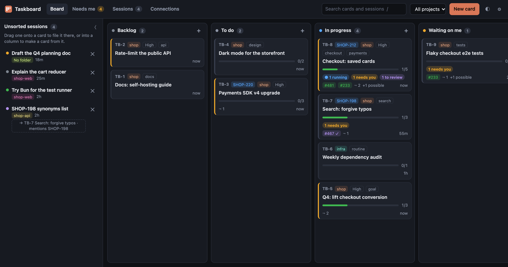
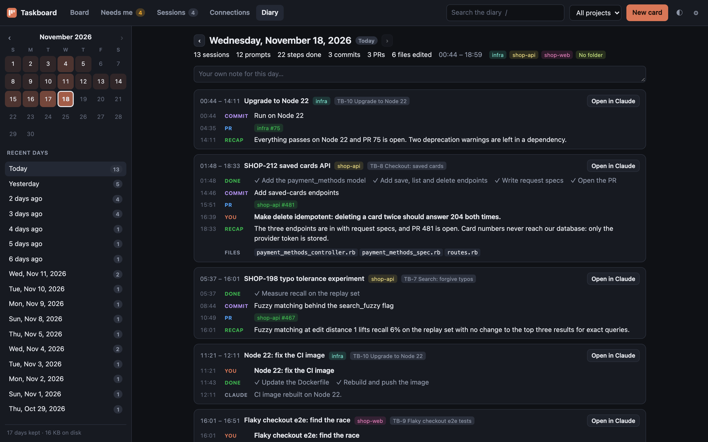
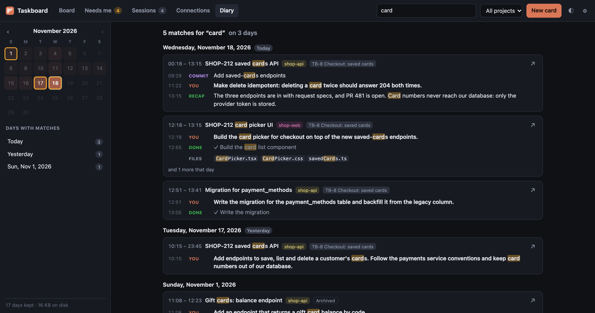
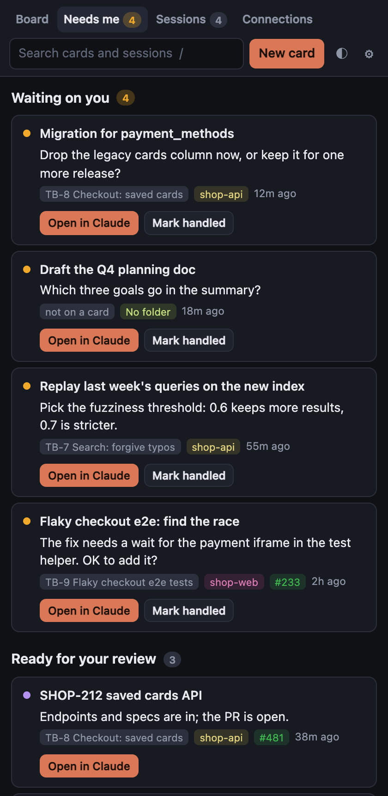
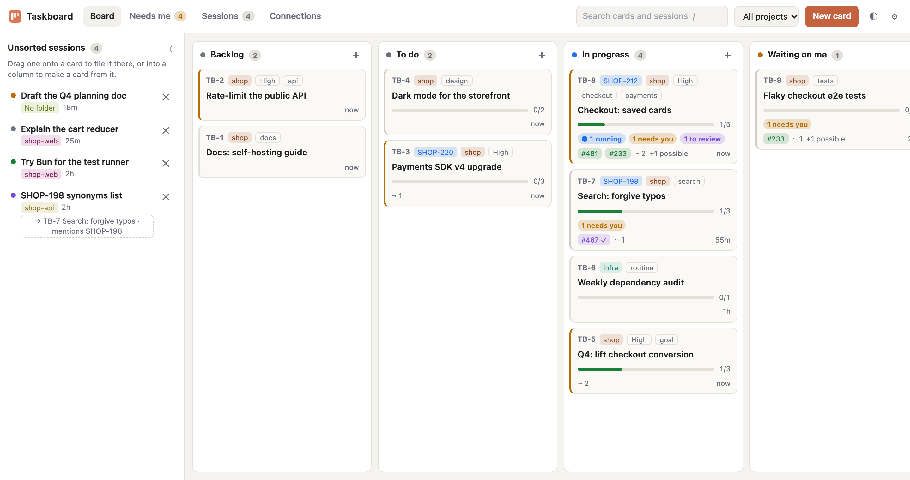

# Taskboard

A local kanban board over your Claude sessions.

A **card** is a task. Its **sub-tasks** are checklist items or **Claude sessions**, and a linked session's status (running, needs you, ready for review, done) is read live from Claude's own files, so nobody has to keep it up to date. Cards can be **connected** (blocks, parent of, related), and Claude sessions can read and update the board themselves. A **Diary** keeps a short, searchable log of what you did each day, including in sessions you have archived or Claude has since deleted.



It is for people who run many Claude Code sessions on related work and lose track of which session belongs to which task, which ones are waiting for an answer, and what is left.

- Runs on your Mac only: a small web server on `127.0.0.1`, one JSON file for the board, no account, no dependencies.
- Reads the Claude desktop app's and Claude Code's session files. It never changes them.
- Keeps a diary of each day's work as short notes, not copies of your sessions: about 12 KB a day.
- Comes with a Mac app (Dock icon, menu-bar count of sessions waiting on you), a `/board` skill and `board_*` tools for Claude, and a `taskboard` command.

The screenshots here show made-up data from [`scripts/demo.js`](scripts/demo.js).

> This is a personal tool, not an Anthropic product. Built and tested on macOS with the Claude desktop app's Code tab and the Claude Code CLI.

## Install

You need macOS, Node 18 or newer, and Claude Code (the `claude` command) and/or the Claude desktop app. The Mac app is optional and needs Xcode's command line tools (`xcode-select --install`).

```bash
git clone https://github.com/mohamedelkadi/claude-taskboard.git
```

```bash
cd claude-taskboard && node src/cli.js install
```

The installer:

1. copies the app to `~/.claude/taskboard/app` (you can delete the clone afterwards)
2. adds the `taskboard` command to `~/.local/bin`
3. installs the `board` skill and registers the `taskboard` MCP server for every Claude Code session
4. starts the board at <http://127.0.0.1:4780/>
5. builds `~/Applications/Taskboard.app` if Swift is available

The first time it runs, it makes a starting board from what it finds: one card per Claude sidebar group, per family of sessions started from one another, and per scheduled task. Sessions that were already open keep working, but need a restart to get the board tools.

To look around without touching your own files, run it on made-up data instead:

```bash
node scripts/demo.js
```

## How to use it

### 1. Open the board

| Where you are | How |
| --- | --- |
| Anywhere on the Mac | The **Taskboard** app: Dock, Launchpad or Spotlight. Its Dock icon carries a badge with the number of sessions waiting on you. |
| Menu bar | The Taskboard item shows the same number. Its menu lists the waiting sessions; clicking one opens that session in Claude. |
| Inside a Claude session | Type `/board`. In the desktop app the board opens in the pane beside the chat. |
| Terminal | `taskboard`, or `taskboard open TB-3` to land on a card. |
| Browser | <http://127.0.0.1:4780/> |

"Open at Login" is in the menu-bar menu. Started at login, the app comes up as the menu-bar item only; the window opens when you click the Dock icon or "Open Taskboard". To keep the icon in the Dock, right-click it → Options → Keep in Dock.

### 2. Sort your sessions into cards

The left rail lists open sessions that are not on a card yet.

- Drag a session **onto a card** to file it there.
- Drag a session **into a column** to make a new card from it.
- A dashed hint under a session (`→ TB-7 · mentions SHOP-198`) is a suggestion; click it to accept.
- Press `n` or use **New card** for a card with no session yet.

The search box (`/`) looks at everything: while you type, the project dropdown and the Sessions filters step aside, and a search finds sessions that are already on a card, or archived, as well as unsorted ones. With nothing typed, the project dropdown counts a session for the repos it ran commands in, not only the folder it started in.

Drag cards between columns to change their status. A dropped card shows in its new column at once; if the board takes more than a moment to save it, the card dims and shows a small spinner, and if the save fails it goes back where it was with a message. A card in a column before **In progress** moves there on its own when one of its sessions starts working (you can switch that off in Settings); nothing else moves a card but you. The chips on a card show how many of its sessions are running, need you, or are ready for review, and which pull requests they opened.

### 3. Open a card

Click a card to see everything about the task in one place.


- **Sub-tasks** are either checklist items you tick yourself or linked sessions. A linked session's status says `· auto`: it follows the session. Pick a status by hand only to override it. A card's sessions are always listed, whatever their state; a session Claude has deleted keeps its name and a link to its days in the Diary.
- **Ticket** takes a tracker key (`SHOP-212`) or a link, for example to a Slack thread.
- **Unfold a session** (the arrow on the right) to see its step list, what it was started with, its branch and cost.
- A session that is **waiting on you** shows its question on the card. **Mark handled** clears it until the session asks again.
- Every session has an **Open in Claude** button, here and wherever else it is listed: the unsorted list, Needs me, Sessions and the Diary. A session that ran in a terminal gets **Copy resume command** instead.
- **Start a session** opens Claude's new-session page in the folder of the card's **Project**, with a brief for this card in the prompt box (it also copies the brief, in case the page opens empty). The folder is the one earlier sessions of that project ran in; for a project no session has run in yet, you pick the folder in Claude. The new session reads the card and links itself to it.
- **Link sessions…** adds existing sessions to the card.
- **Related** opens what the card's sessions worked with in one click: pull requests, artifacts, docs (Google, Confluence, Notion, Figma, Miro) and Slack conversations. The newest few are also on the card in the board. A link counts when you wrote it, Claude showed it to you, or a tool posted or created it, and a Slack conversation counts when a session read it; links in search results and command output do not.

Further down the card:


- **Connections** say how cards relate: *blocks*, *parent of*, *related to*. "Possibly related" rows are ones the board noticed itself, for example two cards whose sessions touch the same pull request; **Connect** makes it a real connection.
- **Which sessions join this card on their own**:
  - a session started with the card's **Start a session** button
  - sessions **started from** a session already on the card
  - sessions filed in a **Claude sidebar group**
  - sessions whose title or branch mentions a **ticket key** (for example `SHOP-212`)
  - all runs of a **scheduled task** show as one sub-task that follows the latest run

  A session you take off a card by hand is not added back.
- **Notes** are where you, and Claude sessions working on the card, leave decisions and where things stand for whoever picks it up next. They render Markdown: headings, lists, tasks, quotes, code blocks and tables.
- **Attachments** are images and files kept on the card, up to 25 MB each. Paste a screenshot or drop a file anywhere on an open card; in a note or the description it also lands where you are typing. Claude sessions get each file's path, so they can open it.

### 4. See what is waiting on you

**Needs me** lists every session that stopped to ask you something, with the question and the card it belongs to, followed by the sessions that are ready for review.


**Focus** shows only what needs a decision now, one at a time, from one project or several. Sessions stopped on a question, a tool approval or a plan come first, then finished turns that asked something in the last 24 hours. A new prompt joins the queue and never replaces the card you are reading. Answer it in Claude: `o` opens the session, `h` marks it handled, and `j` and `k` move between decisions.

### 5. Find any session

**Sessions** lists all of them, with filters for where they are (unsorted, on a card) and their state. Tick several to link them to a card or to make one card from them.


**When you remember what a session was about but not what it was called**, type it in the search box (`/`). A panel under the box lists the sessions whose conversation best matches, with the passages that matched and an **Open in Claude** button. `↑` `↓` move through them, `Enter` opens one and `Esc` closes the panel.

- It looks at what you asked, what Claude replied, and the commands and file paths used. Tool output and subagents are left out.
- Any word can match, and rarer words count for more. A "quoted phrase" has to appear as written.
- A misspelled word is also tried corrected, and the panel says so (`digram` also searches for **diagram**).
- Paste a pull request or ticket link, or type a key like `SHOP-212`, to find the session behind it.
- Likely passwords, tokens and keys are removed before anything is stored, and a session's text leaves the index when Claude deletes its transcript. The index is about 70 MB for 3.7 GB of transcripts, and a first build takes about 10 seconds in the background.

### 6. See how tasks connect

**Connections** draws the cards as a graph: the connections you made, plus dashed ones the board detected. Drag cards to arrange them, scroll to zoom, and tick "Show open sessions" to see the sessions around each card.


### 7. Look back at any day

**Diary** shows one day at a time: every session you worked in, with what you asked, the recap of each turn (or how Claude's reply began when a turn has none), the steps finished, commits, pull requests and files edited. Pick a day in the calendar or step through days with `←` and `→`. The box at the top is your own note for the day.



Type in the search box to search every day at once. Every word has to come up in a session's day, a word also finds its plural, and a "quoted phrase" has to appear as written. The calendar marks the days with matches; click a day's heading to open it.



- **It outlives Claude's own files.** Claude deletes old transcripts, and you archive or delete sessions. The diary keeps the day, and marks a session "No longer in Claude" when it is gone.
- **It is a log, not a copy.** Each entry is the first few hundred characters, and each session is capped at a few dozen entries a day. As a measure, about 200 days of heavy daily use came to 2.5 MB, read from 3.5 GB of transcripts. The size is shown under the calendar.
- **It costs little to keep.** A transcript is read once, in the background (about 6 seconds for those 3.5 GB), then only what is appended to it. Each day is one small file that is not rewritten after the day is over.

### 8. Use it from Claude

Every Claude Code session (desktop app and terminal) gets the `board` skill and the `board_*` tools, so you can ask in plain words:

- "what's on my board" · "what is waiting on me"
- "put this session under the search card"
- "move TB-4 to review" · "TB-4 is blocked by the SDK upgrade card"
- "add a note to the card with where we got to"
- "what did I do yesterday" · "write my standup from the diary" · "when did I fix the export"
- "find the session where we talked about the coupon rollback"

`/board` opens the board beside the chat. The page fits the narrow pane:



Each card is also a file Claude can read: `~/.claude/taskboard/cards/TB-4.md`.

| Tool | What it does |
| --- | --- |
| `board_overview` | The board, and which card this session is on |
| `board_get_card` | One card in full: sub-tasks, what each session is waiting for, connections, notes |
| `board_create_card`, `board_update_card` | Create a card; move or edit one |
| `board_add_subtask`, `board_update_subtask` | Checklist sub-tasks |
| `board_link_session` | Put this session, or another one, on a card |
| `board_connect_cards` | Connect two cards |
| `board_add_note` | Leave context for the next session |
| `board_find_sessions` | Find sessions by title, ticket, PR or state |
| `board_search_conversations` | Search inside every session, for one you remember but cannot name |
| `board_diary` | What you did on a day or over a span of days, or a search across every day |
| `board_diary_note` | Add a line to your own note for a day |

### 9. Use it from the terminal

```text
taskboard ls [--all]            taskboard show TB-3
taskboard add "<title>" [--status "In progress"] [--ticket PROJ-1]
taskboard move TB-3 "In review" taskboard sub TB-3 "<title>"
taskboard note TB-3 "<text>"    taskboard link TB-3 [session-id]
taskboard connect TB-3 TB-7 blocks
taskboard sessions [query] [--unsorted]
taskboard search "<words>" [--project name] [--limit 10]
taskboard diary [today|yesterday|YYYY-MM-DD] [--days 7] [--project name]
taskboard diary --search "<words>"
taskboard start | stop | restart | status | doctor
```

### Shortcuts and theme

`/` search · `n` new card · `f` Focus · `1`–`5` switch view · `←` `→` previous and next day in the Diary · `Esc` close. The ◐ button switches between dark and light.



## What it reads and writes

Reads, never changes:

- `~/Library/Application Support/Claude/claude-code-sessions/` — the desktop app's record of each session (title, PRs, parent session, status summary, archived)
- `~/Library/Application Support/Claude/claude_desktop_config.json` — sidebar groups only
- `~/.claude/projects/*/*.jsonl` — transcripts, for each session's step list, last recap and conversation search
- `~/.claude/sessions/` — which sessions are running or stopped on a prompt
- `~/.claude/history.jsonl` — once, for prompts typed in a terminal in sessions whose transcript Claude had already deleted

Writes:

- `~/.claude/taskboard/board.json` — the board (hourly copies in `backups/`)
- `~/.claude/taskboard/cards/*.md` and `BOARD.md` — generated copies for Claude to read
- `~/.claude/taskboard/attachments/` — the images and files kept on cards. Removing one from its card, or deleting the card, deletes the file
- `~/.claude/taskboard/diary/` — the diary: one file per day in `days/`, and each session's title, project and card in `sessions.json`. Plain JSON; delete a day's file to forget that day
- `~/.claude/taskboard/cache/` — what it has already read from transcripts, and how far. `cache/search/index.db` is the conversation search index; it is safe to delete and is rebuilt from the transcripts
- `~/.claude/skills/board/SKILL.md` — the skill
- `~/.claude.json` — one entry, the `taskboard` MCP server (added with `claude mcp add --scope user`)
- `~/.local/bin/taskboard` — the command
- `~/Applications/Taskboard.app` — the Mac app (built on your Mac from `macapp/`, signed for that Mac only)

The web server listens on 127.0.0.1 only and refuses requests from other sites. Nothing is sent anywhere.

## Update and remove

```bash
node src/cli.js install      # from a clone; run again after pulling or changing the code
```

```bash
taskboard app                # rebuild only the Mac app
```

```bash
taskboard uninstall          # removes the app, skill, MCP entry and command; keeps the board and the diary
```

```bash
taskboard uninstall --purge  # also deletes the board and the diary
```

## Development

```bash
npm test                     # 47 tests, against fake Claude folders in a temp directory
```

```bash
npm run demo                 # the board on made-up data, on port 4781
```

```bash
npm run screenshots          # retake docs/screenshots from the demo (needs Node 22+ and Chrome)
```

No dependencies and no build step. `src/store.js` is the board and its operations; `src/claude.js` reads Claude's files; `src/view.js` joins the two (statuses, detected connections, linking rules, first-run import); `src/diary.js` keeps the diary; `src/search.js` keeps the conversation index; `src/server.js`, `src/mcp.js` and `src/cli.js` are the three ways in; `public/` is the page; `macapp/` is the Mac app, a thin window around that page.

## Limits

- The session files and transcript format are Claude internals, not a documented interface, so a Claude update can change them. `taskboard doctor` shows what is found.
- A session's status summary comes from the desktop app, so sessions run only in a terminal show as idle unless they are running.
- The board is told of changes rather than asking for them. It watches its own file and Claude's session folders, transcripts and prompt history, and tells the page the moment something changes: a card moved from a terminal or by a Claude session shows in about a tenth of a second, a session's progress within a second or two. A check every 15 seconds catches anything the watchers miss, such as a session process that died without writing anything. If the page's connection drops (the Mac slept, the window sat hidden) it reconnects and catches up by itself.
- The diary starts from the transcripts still on disk the first time it runs. For older days it has only what the session records and the terminal's prompt history hold: titles, last reports and prompts.
- The diary holds the beginning of each prompt and reply in plain text, as Claude's own transcripts do. It stays on your Mac, in the folder above.
- Searching inside conversations needs Node 22.13 or newer, for its built-in SQLite. On an older Node everything else works and the search panel says why it is off.
- That search matches words, not meaning, so a description that shares no words with the session can miss it. Removing secrets works from known patterns and can miss an unusual one; the index stays on your Mac, in a folder only you can read.
- macOS only for now: the desktop app's folder and the Mac app are Mac-specific.

## License

[MIT](LICENSE)
